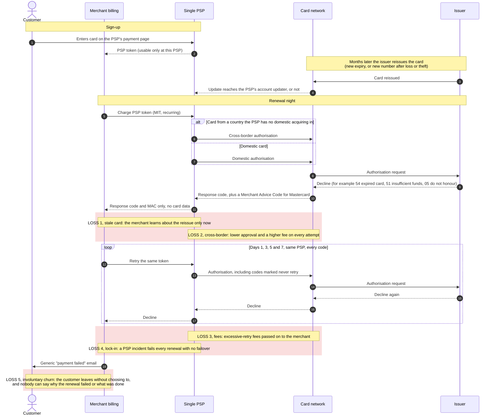
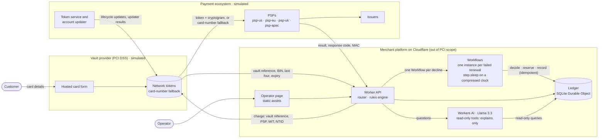
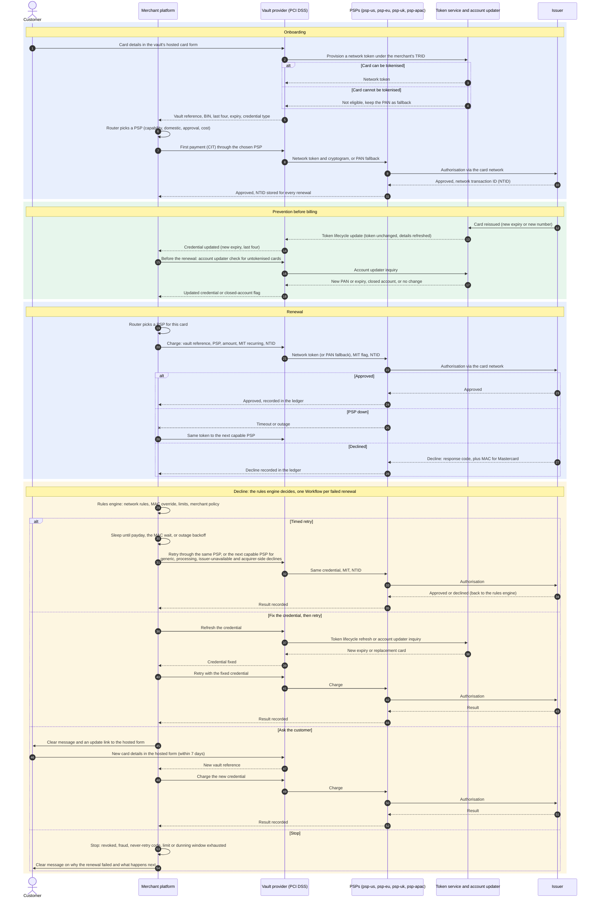

# Card-on-File Decline Recovery

Recovers declined card-on-file subscription renewals on Cloudflare Workers, Workflows, a
SQLite-backed Durable Object and Workers AI.

**Who decides:** a deterministic rules engine makes every decision from public Visa and
Mastercard rules. Llama 3.3 only explains the decisions, through read-only tools.

**Live demo:** https://ba-cofdr.bilalahmed-78.workers.dev

Everything outside the merchant platform is **simulated** and fictional: the vault provider,
token service, account updater, PSPs, issuers, BINs and customers.

## The problem

A subscription merchant charges stored cards on every renewal: merchant-initiated
card-on-file transactions. Every night a share of renewals is declined. Revenue that is
never recovered is involuntary churn: the customer did not choose to leave.

With cards stored as one PSP's tokens, six things go wrong:
1. **Stale cards:** the merchant learns about a reissued card only when a renewal fails.
2. **Lock-in:** no failover, and no route to a better acquirer.
3. **Cross-border acquiring:** cards from other countries get lower approval at higher cost.
4. **Blind retries:** dunning retries every decline on days 1, 3, 5 and 7, including codes
   the networks say must never be retried.
5. **Fees:** those retries incur excessive-retry fees and break the attempt limits.
6. **No explanation:** nobody can say why a renewal failed or what was done about it.

### Problem workflow

Today, with one PSP and blind retries. The red blocks mark where money is lost.



[`docs/DESIGN.md`](docs/DESIGN.md) also has the trust boundaries and the rules engine's decision flowchart.

## Architecture (D4)

- **Vault and tokens:** merchant-owned network tokens (the merchant's own token requestor
  ID) in a provider-hosted PCI DSS vault, with a card-number fallback. The merchant platform
  holds only vault references, BIN, last four and expiry, so it stays out of PCI scope.
- **Prevention before billing:** token lifecycle updates and the account updater. Every
  renewal is sent as a merchant-initiated recurring transaction with the original network
  transaction ID.
- **Router:** picks the PSP for each transaction by capability (token, else card number),
  domestic acquiring, approval rate and cost. It fails over when a PSP is down.
- **Rules engine:** decides each decline from Visa categories, Mastercard Merchant Advice
  Codes and attempt limits, plus merchant policy. The possible decisions are a timed retry
  (same PSP, or another PSP for generic, processing, issuer-unavailable and acquirer-side
  declines), fix the credential, ask the customer, or stop.
- **Workflows:** one instance per failed renewal, sleeping on a compressed clock
  (1 simulated day = 3 s live).
- **Ledger:** one SQLite Durable Object holding payments, attempts, decisions, events and
  chat. Attempts are reserved before the PSP call and recorded after it, and the limits are
  re-checked atomically.
- **Operator page and chat:** one "Run a night" button, live progress (phases, simulated
  clock, activity feed), summary, incidents, payments, a per-payment timeline with the rule
  behind every decision, a chat that shows the tools each answer used, a usage guide and this
  overview.

### Architecture diagram



### Solution sequence

Onboarding, prevention before billing, renewal, decline and each recovery path, with every actor.



```
src/core      rules (configuration), engine, limits, router, time   pure, no I/O
src/sim       SIMULATED vault, token service, updater, PSPs, issuers, customers
src/ledger    ledger logic over SQLite, and the guardrail audit
src/recovery  the recovery loop, shared by the Workflow and the tests
src/worker    Worker API, ledger Durable Object, Workflow, chat
public        operator page
test/unit     decision table (50+ cases), router, limits, simulators, whole-night invariants
test/functional  end-to-end through the API (wrangler dev or the live URL)
```

The guardrails are listed in [`docs/PROMPTS.md`](docs/PROMPTS.md) (prompt 4), and each
decision is in [`docs/adr`](docs/adr). The rules, their sources and confidence are in
[`docs/network-rules.md`](docs/network-rules.md).

## Run it

Requires Node 24 and a Cloudflare account. Workers AI runs remotely, even in dev.

```bash
npm install
```

```bash
npm run typecheck
```

```bash
npm test
```

```bash
npx wrangler dev
```

Functional tests against a running Worker (default `http://localhost:8787`):

```bash
E2E_BASE_URL=http://localhost:8787 npm run test:functional
```

## API

| Method | Path | What it does |
|---|---|---|
| POST | `/api/runs` `{size: "full"\|"ci", start?, seed?, dayMs?}` | Generate a night (2,000 or 350 renewals) and bill it; with `start: true`, also start recovery. One active run at a time (the 409 names it); hourly quotas (the 429 says when they reset) |
| POST | `/api/runs/:id/recover` | Start one Workflow per failed renewal (idempotent). `?restart=1` restarts the ones in progress |
| GET | `/api/runs`, `/api/runs/latest`, `/api/runs/:id` | Runs and the summary, with the naive and legacy comparisons |
| GET | `/api/runs/:id/payments?status=&path=&brand=&psp=&region=&code=&q=` | Declined renewals |
| GET | `/api/payments/:id` | Timeline: attempts, decisions with their rules, events |
| GET | `/api/runs/:id/live?after=` | Live progress: settled, recovered, attempts, and the activity feed since a cursor. The page polls it every second |
| GET | `/api/runs/:id/incidents` | PSP and issuer outages detected in the ledger |
| GET | `/api/runs/:id/export` | The run's ledger rows, which the functional tests audit |
| GET | `/api/runs/:id/workflows` | Workflow instance states for renewals in progress |
| POST | `/api/chat` `{runId, message}` | Operator chat; returns the answer and the tools used |
| GET | `/api/rules` | Every rule with its source and confidence |
| GET | `/api/overview` | This README, shown on the page as the system overview |

**Live updates use polling, not a push channel.** The run's state lives in one Durable
Object, and a cheap aggregate query every second per viewer is simpler than holding
Server-Sent Events or WebSocket connections open. It needs no reconnection logic, and it
works the same under `wrangler dev`. A push channel would only pay off with many concurrent
viewers.

## CI/CD

GitHub Actions (`.github/workflows/ci.yml`):
- **Every push and pull request:** type check and unit tests.
- **On `main`:** deploy with wrangler, then run the functional tests against the live URL.

It needs two repository secrets: `CLOUDFLARE_API_TOKEN` and `CLOUDFLARE_ACCOUNT_ID`.

## Scope and limits

- **Simulated:** every PSP, issuer, card and customer. The recovery figures show how the
  design behaves under the simulator's assumptions; they are not a forecast.
- **Rule readings:** the network rules are readings of public material, each with a
  confidence. Check them against current scheme rules before using them with real payments.
- **Public demo safety:**
  - Hourly quotas apply to generating nights and to chat.
  - Per-IP limits store only a salted hash, never the address.
  - There are no secrets in the repository.
  - Cloudflare resources use the `ba-cofdr` prefix only.

## Prompt history

The prompts that designed and built this project are in [`docs/PROMPTS.md`](docs/PROMPTS.md).
The transcript of the build session is in
[`docs/PROMPT_HISTORY.md`](docs/PROMPT_HISTORY.md).
