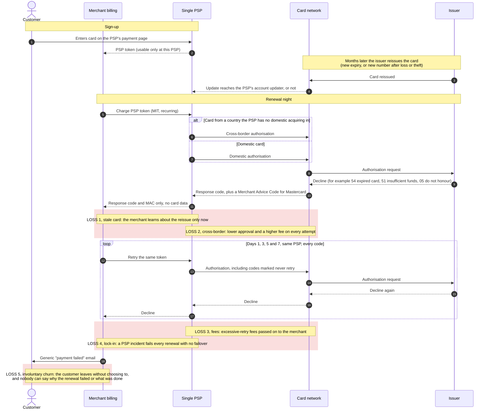
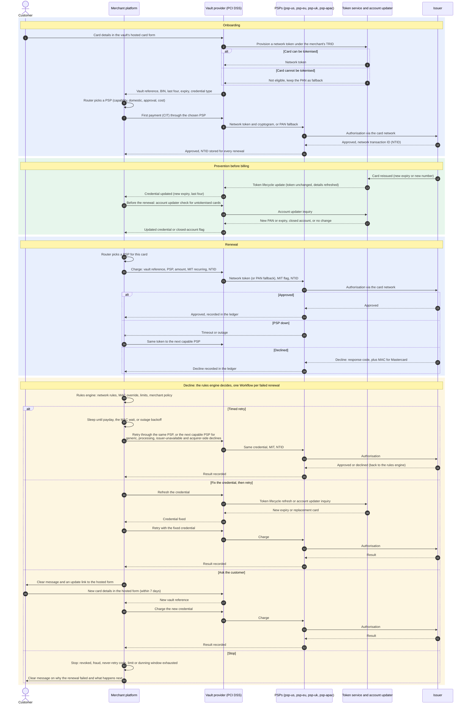
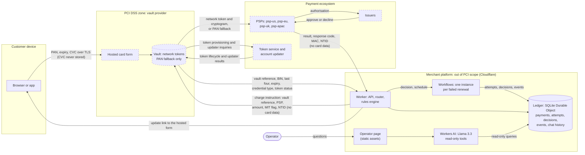
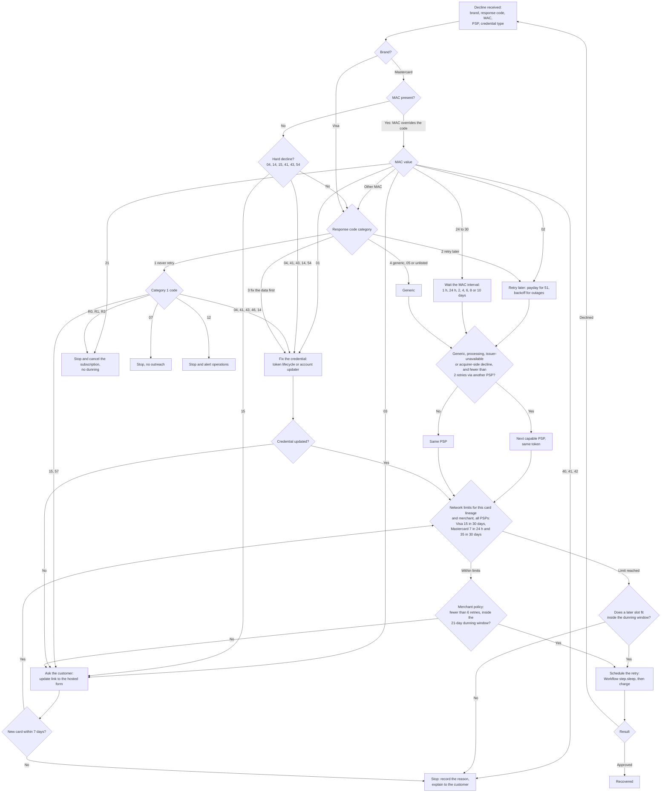

# Design: Card-on-File Decline Recovery

Status: built. Written before any code, then updated with the decisions of 16 Nov 2026
(Category 1 handling, paydays, outages, quotas). The rules as implemented, with their sources
and confidence, are in [network-rules.md](network-rules.md); the decisions are in [adr](adr).

## 1. The problem

A subscription merchant charges its customers' stored cards on every renewal. These are
merchant-initiated card-on-file transactions (MIT). Every night a share of renewals is
declined, and the revenue that is never recovered is involuntary churn: the customer did not
choose to leave.

Today the merchant stores cards as tokens at a single PSP. That token works only at that PSP,
the PSP's account updater is a black box, cards from countries the PSP does not acquire in
domestically go cross-border, and the dunning job retries every decline on days 1, 3, 5 and 7
on the same route.

### Problem sequence: where money is lost

Red blocks mark where revenue or money is lost.

## 2. The solution

**Target architecture (D4): merchant-owned network tokens in a provider-hosted vault.**

- **Onboarding.** The customer enters the card in a hosted card form run by a PCI DSS vault
  provider. The vault provisions a network token under the merchant's own token requestor ID
  (TRID), so the merchant owns the token and can send it through any capable PSP. The vault
  keeps the card number (PAN) only as a fallback for cards that cannot be tokenised. The
  merchant platform receives only a vault reference, BIN, last four and expiry, so it stays out
  of PCI scope. The first payment is customer-initiated (CIT) and returns the network
  transaction ID (NTID) that every later renewal carries.
- **Prevention before billing.** The networks push token lifecycle updates (new expiry,
  replacement card) to the vault. The account updater covers cards without a token. Every
  renewal is sent as an MIT recurring transaction carrying the NTID of the first payment.
- **Routing.** A deterministic router picks the PSP per transaction by (1) capability: does
  this PSP accept this brand's network tokens in this region, otherwise fall back to the PAN;
  (2) domestic acquiring for the BIN's issuing country; (3) measured approval rate; (4) cost.
  If a PSP is down, the next capable PSP gets the same token.
- **Recovery.** A deterministic rules engine decides what happens after each decline, from
  public Visa and Mastercard rules only (section 4). It never calls the language model.
- **Explanation.** An operator asks in chat, for example "Why did 300 renewals fail last
  night?". Llama 3.3 on Workers AI answers by calling read-only tools over the ledger. It
  explains; it never decides.

### Solution sequence

## 3. Entities and trust boundaries

The PCI DSS zone holds every card number and cryptogram. Nothing in the merchant platform can
reconstruct a card number. Dashed boxes are simulated in this build (section 6).

| Boundary | Crosses | Never crosses |
|---|---|---|
| Customer to vault | PAN, expiry, CVC (TLS, hosted form) | Anything to the merchant directly |
| Vault to merchant | Vault reference, BIN, last four, expiry, credential type, token status | PAN, CVC, cryptogram, network token value |
| Merchant to vault | Charge instruction: vault reference, PSP, amount, currency, MIT flag, NTID | Card data (the merchant has none) |
| Vault to PSP | Network token and cryptogram, or PAN fallback; MIT flag; NTID | CVC on renewals |
| PSP to merchant | Result, response code, MAC, NTID, PSP reference | Card data |
| Ledger to Workers AI | Read-only query results (aggregates, attempts, decisions) | Write access; any card data |

## 4. Rules engine decision flow

Deterministic: the same decline, history and configuration always give the same decision.
Every rule carries its source in configuration.

**Network rules (as specified, to be checked).**

| Brand | Rule | Codes | Meaning |
|---|---|---|---|
| Visa | Category 1 | 04, 07, 12, 14, 15, 41, 43, 46, 57, R0, R1, R3 | Never retry the credential. 07 stop, no outreach; 04, 41, 43, 46, 14 refresh the credential, else ask the customer; 15, 57 ask the customer; 12 stop and alert operations; R0, R1, R3 cancel, no dunning |
| Visa | Category 2 | 03, 19, 51, 59, 61, 62, 65, 75, 78, 86, 91, 93, 96, N3, N4, 5C, 9G | Issuer cannot approve now: retry later |
| Visa | Category 3 | 54, 55, 63, 6P, 82, N7 | Data quality: fix the data first |
| Visa | Category 4 | 05 and any unlisted code | Generic |
| Mastercard | MAC 01 | | Updated information needed: account updater |
| Mastercard | MAC 02 | | Try again later |
| Mastercard | MAC 03 | | Do not try again: never retry this card; ask the customer for another |
| Mastercard | MAC 21 | | Recurring payment cancelled: cancel, no dunning |
| Mastercard | MAC 24 to 30 | | Retry after 1 h, 24 h, 2, 4, 6, 8, 10 days |
| Mastercard | MAC 40, 41, 42 | | Never retry: stop and tell the customer |
| Mastercard | Hard decline, no MAC | 04, 14, 15, 41, 43, 54 | Never retry the same credential: refresh it (15: ask the customer) |
| Visa | Retry limit | | 15 in 30 days per card lineage and merchant |
| Mastercard | Retry limit | | 7 in 24 hours and 35 in 30 days per card lineage and merchant |

Limits count every attempt for the card lineage (the original card and its replacements) at the
merchant, across all PSPs, original attempt included.

**Merchant policy (separate from network rules).** At most 6 retries per renewal; a 21-day
dunning window; 7 days for the customer to respond; at most 2 retries via another PSP.

## 5. Problems and fixes

| # | Problem | Fix in this design | Where it lives |
|---|---|---|---|
| 1 | Stale cards: the merchant learns about a reissue only when a renewal fails | Network token lifecycle updates pushed to the vault; account updater for untokenised cards, checked before billing; "fix the credential" recovery path | Vault, token service, account updater; rules engine |
| 2 | Lock-in: the PSP token works only at one PSP, no failover | Network token under the merchant's own TRID, held in a provider-hosted vault and usable at any capable PSP; router fails over to the next capable PSP | Vault; router |
| 3 | Cross-border acquiring | Router prefers a PSP with domestic acquiring for the BIN's issuing country | Router |
| 4 | Blind retries | Rules engine classifies every decline by Visa category or Mastercard MAC and response code; never-retry codes stop; timed retries wait for payday, the MAC interval or outage backoff | Rules engine, Workflows |
| 5 | Fees and attempt caps | Limits counted per card lineage and merchant across all PSPs, checked before every retry; merchant policy caps retries and the dunning window | Rules engine, ledger |
| 6 | No explanation | Every attempt, decision and rule source is in the ledger; operator chat explains through read-only tools; the customer gets a specific message with an update link | Ledger, Workers AI, operator page |

## 6. What is real and what is simulated

| Component | In this build | Notes |
|---|---|---|
| Router | Real | TypeScript, deterministic |
| Rules engine | Real | TypeScript, deterministic, rules and sources in configuration |
| Workflows | Real | One instance per failed renewal; `step.sleep` on a compressed clock (one simulated day = a few seconds, configurable) |
| Ledger | Real | SQLite-backed Durable Object: payments, attempts, decisions, events, chat history |
| Operator chat | Real | Llama 3.3 on Workers AI with function calling over read-only ledger tools |
| Operator page | Real | Static assets served by the Worker |
| Vault provider and hosted form | Simulated | Seeded and deterministic; returns vault references, never a card number |
| Token service and account updater | Simulated | Seeded lifecycle events and updater results |
| PSPs | Simulated | Fictional `psp-us`, `psp-eu`, `psp-uk`, `psp-apac` with capability, domestic regions, approval rates, cost and outages |
| Issuers and BINs | Simulated | Fictional BIN ranges and issuers; seeded decline behaviour |

Every simulated component is labelled as simulated in code, in the ledger and on the operator
page. Each payment carries an explicit credential type (network token or PAN fallback), the
MIT flag and the NTID.

## 7. Decisions taken (16 Nov 2026)

- Category 1 handling per code, as in the table above.
- Paydays: the 1st, 15th and 25th and the last day of the month. 30% of customers respond.
  Each night has one PSP outage window and one issuer outage.
- A card the customer enters is charged at once as a customer-initiated payment, outside the
  retry budget, as a new card lineage with a new network transaction ID.
- Mastercard 54 (expired card) refreshes the credential rather than stopping.
- The cascadable codes are generic (05 and unlisted), 19, 91, 92 and 96, and PSP unavailable.

## 8. Open points to check against the sources

1. The Visa category code lists and the 15-in-30-days limit; whether the limit is per card or
   per card and merchant, and how replacement cards count.
2. The Mastercard limits (7 in 24 hours, 35 in 30 days) and which reading the networks
   currently publish; MAC 40 to 42 meanings.
3. Whether an MIT carrying a network token still needs the NTID of the first CIT, and what
   happens to the NTID when the customer enters a new card through the update link.
4. Which decline codes count as processing, issuer-unavailable or acquirer-side for routing to
   another PSP (proposed: 91, 96 and PSP-side errors).
